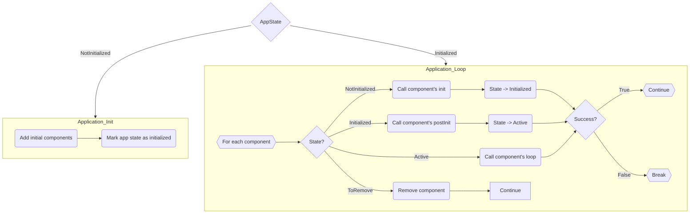

# ksIotFrameworkLib

> Arduino Library for ESP32/ESP8266 - a composition-oriented Internet of Things framework that provides a simple and extendable architecture, handles device setup (WiFi setup, MQTT and application-specific configuration), network connectivity, MQTT telemetry protocol, and more...

---

<div align="center">

[![zread](https://img.shields.io/badge/Ask_Zread-_.svg?style=for-the-badge&color=00b0aa&labelColor=000000&logo=data%3Aimage%2Fsvg%2Bxml%3Bbase64%2CPHN2ZyB3aWR0aD0iMTYiIGhlaWdodD0iMTYiIHZpZXdCb3g9IjAgMCAxNiAxNiIgZmlsbD0ibm9uZSIgeG1sbnM9Imh0dHA6Ly93d3cudzMub3JnLzIwMDAvc3ZnIj4KPHBhdGggZD0iTTQuOTYxNTYgMS42MDAxSDIuMjQxNTZDMS44ODgxIDEuNjAwMSAxLjYwMTU2IDEuODg2NjQgMS42MDE1NiAyLjI0MDFWNC45NjAxQzEuNjAxNTYgNS4zMTM1NiAxLjg4ODEgNS42MDAxIDIuMjQxNTYgNS42MDAxSDQuOTYxNTZDNS4zMTUwMiA1LjYwMDEgNS42MDE1NiA1LjMxMzU2IDUuNjAxNTYgNC45NjAxVjIuMjQwMUM1LjYwMTU2IDEuODg2NjQgNS4zMTUwMiAxLjYwMDEgNC45NjE1NiAxLjYwMDFaIiBmaWxsPSIjZmZmIi8%2BCjxwYXRoIGQ9Ik00Ljk2MTU2IDEwLjM5OTlIMi4yNDE1NkMxLjg4ODEgMTAuMzk5OSAxLjYwMTU2IDEwLjY4NjQgMS42MDE1NiAxMS4wMzk5VjEzLjc1OTlDMS42MDE1NiAxNC4xMTM0IDEuODg4MSAxNC4zOTk5IDIuMjQxNTYgMTQuMzk5OUg0Ljk2MTU2QzUuMzE1MDIgMTQuMzk5OSA1LjYwMTU2IDE0LjExMzQgNS42MDE1NiAxMy43NTk5VjExLjAzOTlDNS42MDE1NiAxMC42ODY0IDUuMzE1MDIgMTAuMzk5OSA0Ljk2MTU2IDEwLjM5OTlaIiBmaWxsPSIjZmZmIi8%2BCjxwYXRoIGQ9Ik0xMy43NTg0IDEuNjAwMUgxMS4wMzg0QzEwLjY4NSAxLjYwMDEgMTAuMzk4NCAxLjg4NjY0IDEwLjM5ODQgMi4yNDAxVjQuOTYwMUMxMC4zOTg0IDUuMzEzNTYgMTAuNjg1IDUuNjAwMSAxMS4wMzg0IDUuNjAwMUgxMy43NTg0QzE0LjExMTkgNS42MDAxIDE0LjM5ODQgNS4zMTM1NiAxNC4zOTg0IDQuOTYwMVYyLjI0MDFDMTQuMzk4NCAxLjg4NjY0IDE0LjExMTkgMS42MDAxIDEzLjc1ODQgMS42MDAxWiIgZmlsbD0iI2ZmZiIvPgo8cGF0aCBkPSJNNCAxMkwxMiA0TDQgMTJaIiBmaWxsPSIjZmZmIi8%2BCjxwYXRoIGQ9Ik00IDEyTDEyIDQiIHN0cm9rZT0iI2ZmZiIgc3Ryb2tlLXdpZHRoPSIxLjUiIHN0cm9rZS1saW5lY2FwPSJyb3VuZCIvPgo8L3N2Zz4K&logoColor=ffffff)](https://zread.ai/cziter15/ksIotFrameworkLib)
[](https://cziter15.github.io/ksIotFrameworkLib)
[](https://github.com/cziter15/ksIotFrameworkLib/wiki)
[](https://github.com/cziter15/ksIotFrameworkLib?tab=License-1-ov-file#readme)

[](https://github.com/cziter15/ksIotFrameworkLib/actions/workflows/build-examples.yml)
[](https://app.codacy.com/gh/cziter15/ksIotFrameworkLib/dashboard?utm_source=gh&utm_medium=referral&utm_content=&utm_campaign=Badge_grade) 
[](https://github.com/cziter15/ksiotframeworklib)
[](https://platformio.org)
[](https://github.com/pioarduino)


</div>

## 🌟 Introduction

**`ksIotFrameworkLib`** is an **Arduino-based C++ framework** designed for **ESP32 and ESP8266** microcontrollers.  

The library handles the typical IoT boilerplate for you, from initial Wi-Fi provisioning via a captive portal to MQTT connectivity with a robust reconnection mechanism. It also includes a built-in LAN-accessible web portal for device configuration, over-the-air firmware updates, live status monitoring, and terminal access. The terminal, a special feature of the web portal, lets you view real-time application logs and define your own commands.

By handling these repetitive foundations, `ksIotFrameworkLib` lets you concentrate on the unique logic of your smart sensors, controllers, or DIY automations - without needing to reinvent connectivity or configuration layers every time.

### 🚀 Potential use cases

- Smart home solutions (services, monitoring, alarming)
- Telemetry systems (sending sensor data, device statuses)
- Remote control applications (switching devices, executing commands)

> 💡 The library is not limited to these examples - it’s designed to support a wide range of IoT projects. For instance, one of my personal implementations involves remotely controlling a heating boiler, fully integrated with Home Assistant via MQTT. I have devices running **continuously for months without interruptions**, demonstrating the library’s stability and reliability in real-world deployments.

### 📜 Motivation to create the library

- Create a **solid starting point** for developing applications targeting Espressif microcontrollers.
- **Streamline** the process of adapting and reusing code across multiple devices.
- Apply the **DRY principle** (Don't Repeat Yourself) to DIY IoT projects by consolidating common functionality into a simple, reusable library.

### 📚 Documentation

- Detailed documentation can be found [here](https://cziter15.github.io/ksIotFrameworkLib).

### 📟 Examples

- For examples, refer to the [examples directory](https://github.com/cziter15/ksIotFrameworkLib/tree/master/examples).

---

> **IMPORTANT FOR ESP32**
>
> This library targets Arduino 3+ on ESP32. Due to [PlatformIO limitations](https://github.com/platformio/platform-espressif32/issues/1225), it does not automatically fetch the latest versions.
> Use the pioarduino fork by Jason2866 in your `platformio.ini` file:
> ```ini
> platform = https://github.com/pioarduino/platform-espressif32/releases/download/stable/platform-espressif32.zip
> ```
>
> **IMPORTANT FOR ESP8266**
>
> For ESP8266, the latest supported version is based on SDK305.
> To use it, please add this build flag:
> 
> ```
> DPIO_FRAMEWORK_ARDUINO_ESPRESSIF_SDK305
> ```

---

### 🛠️ Architecture



- Only one application runs at a time.
- Each application manages its own set of components, the framework's core building blocks.
- Component states are managed within the application's `loop` function.
- Components implement `init`, `postInit`, and `loop` methods.
- Components marked for removal are safely deleted in the next cycle.

#### 📏 Utilities and components structure

```text
    📁 ksf
    ├── 📄 ksAppRotator                 ─── Application rotator component
    ├── 📄 ksApplication                ─── Base application class
    ├── 📄 ksRtti                       ─── Implements RTTI (run-time type information) for objects
    ├── 📄 ksComponent                  ─── Base component class
    ├── 📄 ksConstants                  ─── Basic low-level definitions
    ├── 📂 evt
    │   ├── 📄 ksEvent                  ─── Event system implementation
    │   ├── 📄 ksEventHandle            ─── Event handle management
    │   └── 📄 ksEventInterface         ─── Event interface definition
    ├── 📂 misc
    │   ├── 📄 ksPinnedTlsClient        ─── Fingerprint-pinned TLS client
    │   ├── 📄 ksConfig                 ─── Configuration file handling
    │   ├── 📄 ksDomainQuery            ─── Custom DNS implementation
    │   ├── 📄 ksSimpleTimer            ─── Simple timer functionality
    │   └── 📄 ksWSServer               ─── Internal WS handling for device portal
    ├── 📂 res
    │   └── 📄 otaWebpage               ─── OTA update webpage resources
    └── 📂 comp
        ├── 📄 ksConfigProvider         ─── Manages configuration parameters and storage
        ├── 📄 ksDevStatMqttReporter    ─── Sends periodic device status updates via MQTT
        ├── 📄 ksDevicePortal           ─── Implements a web-based configuration portal
        ├── 📄 ksLed                    ─── Simplifies LED control
        ├── 📄 ksMqttConfigProvider     ─── Manages MQTT-related configuration
        ├── 📄 ksMqttConnector          ─── Handles MQTT connection management
        ├── 📄 ksResetButton            ─── Implements reset button functionality
        ├── 📄 ksWifiConfigurator       ─── Handles WiFi configuration setup
        └── 📄 ksWifiConnector          ─── Manages WiFi connection
```

#### 🔅 Rules

- Components should be added in the app's `init` method, so they will be available for `postInit` methods. (you can anytime later, from the `loop` but please treat it like exceptional case)
- The `init` method is the best place to add dependent components, setup initial pin values etc.
- The `postInit` method is the best place to obtain a weak pointer to another component by calling `findComponent`. This will handle cases when other components were added via `init` method.

---

### 🌱 Building the Application

To create an application, define a new class that inherits from `ksApplication` and add initial components in the `init` method. Refer to projects like [**emon_fw**](https://github.com/cziter15/emon_fw) for a practical example.

#### 🔎 How It Works

- The application is instantiated, and its `init` method is called. If `init` returns `false`, the `loop` method is skipped, and the App Rotator proceeds to instantiate and run the next application in its sequence.
- If `init` returns `true`, the `loop` method executes, initializing all components.
- In the next iteration, each component’s `postInit` method is invoked.
- Once initialized, the application enters a continuous loop, calling each component’s `loop` method.
- If any component’s `loop` method returns `false`, the application terminates, and the App Rotator proceeds to the next application.

```cpp
bool PelletInfo::init()
{
    // Add WiFi and MQTT debug components
    addComponent<ksf::comps::ksWifiConnector>(PelletInfoConfig::pelletInfoDeviceName);
    addComponent<ksf::comps::ksMqttDebugResponder>();
    addComponent<ksf::comps::ksDevStatMqttReporter>();

    // Add OTA updater component
    addComponent<ksf::comps::ksDevicePortal>();

    // Add state display and receiver components
    addComponent<comps::StateDisplay>();
    addComponent<comps::StateReceiver>();

    // Add reset button component
    addComponent<ksf::comps::ksResetButton>(CFG_PUSH_PIN, LOW);

    // Add MQTT connector component
    addComponent<ksf::comps::ksMqttConnector>();

    // Initialization completed; return true to indicate success
    return true;
}
```

---

### 🔁 Application rotator

The library provides a very useful utility called `ksAppRotator`. This object can wrap application instantiation logic into a carousel-like rotation mechanism.

Typically, a device hosts two applications:

- Core application - Runs the core device logic.
- Configuration assistant - Assists the user with device configuration.

Each application implements its own `loop()` method to manage its logic. In case of a failure at any point (including during the application’s construction), the rotator will seamlessly switch to the next application and begin executing its logic.

This design is highly flexible. For example, you can trigger a failure (`return false`) during an application’s `init()` method, allowing the system to immediately switch into configuration mode if conditions require it (e.g. missing WiFi credentials).

---

### 🧩 Miscellaneous

#### 🔣 Compiler flags / Custom RTTI

- Bare Arduino projects need to have `gnu++2a` enabled via `compiler.cpp.extra_flags=` option in the `board.txt` file.
- Use the `KSF_RTTI_DECLARATIONS` macro to provide proper runtime type information generation for proper casting of components. 
- See `ksConfigProvider.h` for an example. Your application components should use this macro, otherwise the component finding mechanism won't work.

#### 🔥 Saving power

- Modem sleep is enabled by default and can be controlled as an optional parameter in the `ksWifiConnector` constructor.
- Automatic modem sleep requires the DTIM _(Delivery Traffic Indication Message)_ to be correctly set on the access point. 
- The best value for me was `3`. It allows the ESP32 to go down from around 100mA to 20mA.

---

### 📑 Dependencies

- **It is highly recommended to use PlatformIO as it will automatically download dependencies!**

#### 🔡 Frameworks

- [Arduino for ESP32](https://github.com/espressif/arduino-esp32)
- [Arduino for ESP8266](https://github.com/esp8266/Arduino)

#### 🔡 Libraries

- [PubSubClient](https://github.com/cziter15/pubsubclient) originally developed by [@knolleary](https://github.com/knolleary)
- [arduinoWebSockets](https://github.com/cziter15/arduinoWebSockets) originally developed by [@Links2004](https://github.com/Links2004)
